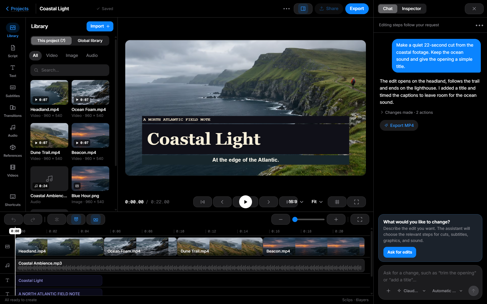
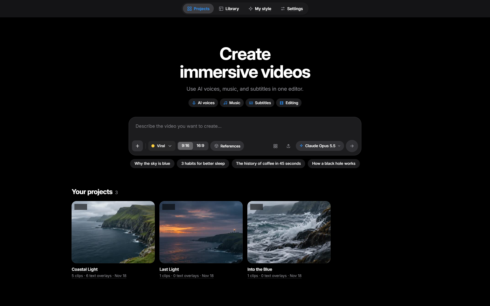
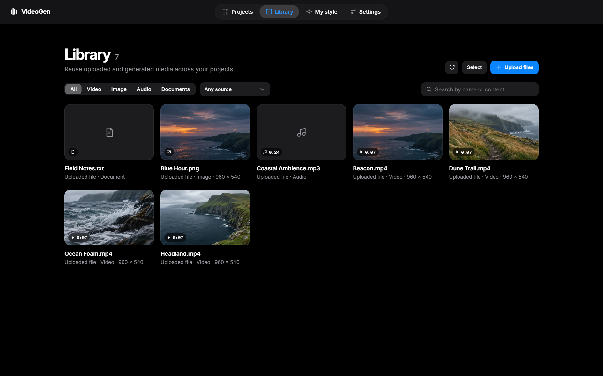

# VideoGen

[Screenshots](#screenshots) · [Getting started](#getting-started) · [Desktop app](#desktop-app-windows-11) · [Contributing](CONTRIBUTING.md) · [License](#license)

VideoGen is a local video editor. Import clips, edit them on a timeline, add text or subtitles, and export to MP4 with [HyperFrames](https://hyperframes.heygen.com/). You can also use AI to write a script, generate narration and motion graphics, and find stock footage.



## Screenshots

| Projects | Media library |
| --- | --- |
| [](docs/screenshots/projects.png) | [](docs/screenshots/media-library.png) |

## Getting started

Install Git, Node.js 22.23.5 LTS with npm, and put `ffmpeg` and `ffprobe` on your `PATH`.

```sh
git clone https://github.com/roberthgnz/ai-videogen.git
cd ai-videogen
npm ci
npm run dev
```

Open [127.0.0.1:3000](http://127.0.0.1:3000), import a clip, and choose **Export** in the studio. Editing, local transcription, and MP4 export work without an account, API keys, or `.env.local`.

The server listens on the local interface. SQLite is created and migrated on first use. Projects, media, caches, and renders live in `storage/` by default. Set `STORAGE_DIR` to use another location. Put optional music and sound effects in `storage/music/` and `storage/sfx/`.

The first render or transcription may need internet access to download Chrome headless, a transcription engine, or its model. If a render fails, `node node_modules/hyperframes/bin/hyperframes.mjs doctor` shows whether HyperFrames can find FFmpeg and Chrome.

### Language

VideoGen supports English and Spanish. It starts with the operating system language and falls back to English for other languages. Choose **Settings → Appearance → Language** to use a different language. Saving a language change reloads the studio. The setting is kept with the other application preferences in `storage/settings.json`.

### Optional services

Copy [`.env.example`](.env.example) to `.env.local`, fill in the settings for the services you use, and restart the web server. On Windows PowerShell, use `Copy-Item .env.example .env.local`. On macOS or Linux, use `cp .env.example .env.local`. In the desktop app, manage keys from **Settings → Services**.

| Feature | Configuration |
| --- | --- |
| Manual editing, text, local subtitles, and export | No keys |
| Script generation from a topic | `ANTHROPIC_API_KEY` |
| Synthetic narration | `FISH_AUDIO_API_KEY` or `ELEVENLABS_API_KEY`. Choose a project voice or set `TTS_DEFAULT_VOICE_ID`. |
| Stock footage | `PIXABAY_API_KEY`. With no key, generated scenes use an animated background. |
| Studio assistant | `ANTHROPIC_API_KEY`, or an installed and signed-in Claude Code or Codex. Choose an engine under **Settings → Agent**. |

## Desktop app (Windows 11)

The Tauri v2 launcher starts the standalone Next.js server on an available `127.0.0.1` port and opens the studio once migrations finish. The installer includes the Node, FFmpeg, Chrome, and Whisper runtimes.

### Develop and build

On Windows x64, install Node **22.23.5**, stable Rust with the MSVC target, and Visual Studio Build Tools with **Desktop development with C++** and the Windows SDK. The build needs access to the npm registry and the artifact sources.

```powershell
npm ci
npm run desktop:dev
npm run desktop:build
```

Both desktop commands run `desktop:prepare`. It checks artifact SHA-256 hashes against `desktop/artifacts.lock.json`, installs dependencies from `desktop/runtime/package-lock.json`, and generates `src-tauri/resources` and `src-tauri/binaries`. These generated files stay local. The bundle includes Node 22.23.5, better-sqlite3 13.0.3, FFmpeg and ffprobe 8.1.2, HyperFrames 0.9.33, Chrome headless 152.0.7977.30, Whisper 1.9.5 with the multilingual small model, and the Visual C++ runtime.

`desktop:dev` uses the packaged production server with the native launcher in debug mode. For React hot reload, use `npm run dev`. Open `http://127.0.0.1:3000/?desktop-preview=1` to preview the desktop layout in the browser. Native window effects, credentials, and dialogs require Tauri.

### Install and use

`desktop:build` writes a per-user NSIS installer to `src-tauri/target/release/bundle/nsis/`. Run the `*-setup.exe` file. The WebView2 bootstrapper needs internet access if WebView2 is missing.

On first launch you can import the `storage` folder from the web app. VideoGen copies the files and makes a consistent SQLite copy. The desktop app keeps its data in `%APPDATA%/com.videogen.desktop/storage` and migrates the database before opening the studio.

Open **Settings** to save Anthropic, Fish Audio, ElevenLabs, and Pixabay keys in Windows Credential Manager. You can also import those four keys from an existing `.env.local`. Saved values never appear in the form. Enter a replacement to update a key or choose **Remove key**. Restart the app to apply changes.

**Download MP4** uses the system Save dialog and copies the file without loading the entire video into the webview. Projects can open in separate windows and external links open in the default browser. Closing the main window stops the server and its render processes.

The desktop appearance follows the system theme and accent. It uses Mica and Snap Layouts on Windows 11 where available and uses a solid background in high-contrast mode or when transparency is disabled. Video rendering uses its own theme in `src/theme.ts`.

See the [desktop third-party notices](THIRD_PARTY_NOTICES.md#desktop-installer) for the bundled components.

## Editing a video

- Start with a topic, import a video, or create a project from scratch. All projects use the same studio with a library, preview, timeline, and assistant. Select an item to open its inspector. Press **F** for focus mode.
- Import MP4, MOV, WebM, MKV, audio, PNG, JPG, WebP, and TXT, Markdown, JSON, or CSV documents. The limit is 256 MB per file, 1 MB per document, and two hours per media file. The server normalizes media to MP4, MP3, or PNG.
- Drag clips from the library to the timeline, trim at either end, split at the playhead, adjust framing or volume, and zoom or resize the timeline. Arrow keys move or trim a focused element by frames. Shift increases the step and Alt disables snapping while dragging.
- Use **Auto-cut silences** to remove intervals of at least 0.45 seconds below −35 dB across the tracks. You can undo these changes while the studio is open.
- Generate subtitles from the original audio with a local model or import SRT or VTT. Correct the words, apply a common style, or edit the video by cutting segments from the transcript.
- Select a music track to sync cuts to detected beats. Review text timing after the cuts change. Use the track controls to place and level replacement audio manually.
- Double-click text to edit it in the preview. Enter confirms and Esc cancels. Drag the text or use the arrow keys to move it. Position, width, typography, color, background, alignment, and timing are carried into the export.
- Add design references, brand notes, storyboards, UI captures, or launch briefs. Files imported as references stay off the timeline. The assistant receives attached documents along with visual samples from up to four recent reference files. Reference links supply context and their URLs are saved with the project.
- Changes to the timeline save automatically after a pause. **Export** shows the format, duration, and quality, then saves and renders a copy with the clip audio. The studio checks the revision before saving to protect changes made in another window or by the assistant.

### Editing with the assistant

The assistant applies requests like “move that title up” to the selected fields. Use edit notes for local corrections to an existing timeline. The assistant reviews the cuts, text, and layers with batches of frame samples and can resume an interrupted review.

For original visuals, `create_graphic` renders HTML, CSS, and a GSAP timeline into a silent clip. It can replace a shot, insert a clip at a specified time, or reuse styles from a related graphic. The studio keeps each source in `source.json` beside the resulting clip and returns sample frames to the assistant. The graphic authoring instructions are in [the studio skill](agent-skills/custom-graphics/SKILL.md).

For multiple scenes, named effects, or HyperFrames blocks, the assistant can author compositions under `agent/compositions/` and import them with `render_composition`. It uses the project's pinned HyperFrames CLI. The studio handles rendering, audio, and subtitles. See [the compositions skill](agent-skills/hyperframes-compositions/SKILL.md).

### Generating a video from a script

1. Enter a topic, choose a style, and create the project. The script tool in the studio groups scenes, narration, visuals, and generation settings.
2. Edit the scenes and save the script. **Voice and style** contains the duration, tone, format, provider voice, subtitle style, and transitions.
3. Generate narration for all scenes or for an individual scene. Each scene shows its audio and synchronized words.
4. Find stock footage for each 2–4 second shot. Edit the search terms, pick another candidate, or build the timeline without stock footage and make original graphics.
5. Render a draft preview of one scene, or generate the full video. **Exports** collects playable versions, failures, retries, cancellations, and downloads.

Changing narration regenerates audio for that scene. Changing the template reuses its audio. A retry keeps completed work.

## Architecture

| Directory | Responsibility |
| --- | --- |
| `src/lib/editing/` | Media import, timeline, transcript editing, notes, references, and timeline rendering |
| `src/lib/pipeline/script/` | Anthropic generation and Zod validation |
| `src/lib/pipeline/tts/` | Fish Audio and ElevenLabs, with a cache for matching voice, text, model, and settings |
| `src/lib/pipeline/alignment/` | Mapping provider timestamps back to words in the script |
| `src/lib/pipeline/visuals/` | Pixabay search, shot selection, download, and normalization |
| `src/lib/pipeline/audio/` | Music, ducking, effects, and loudness normalization |
| `src/lib/pipeline/composition/` | HyperFrames scenes, captions, and shared layout |
| `src/lib/pipeline/render/` | HyperFrames CLI rendering, progress, and cancellation |
| `src/templates/` | Scene schemas, editor fields, HTML, and render composition functions |

The script generator uses `ANTHROPIC_MODEL` and retries once with validation issues if the result is invalid. Set `TTS_PROVIDER` to `fishaudio` or `elevenlabs`. When unset, Fish Audio is selected if its key is present. VideoGen aligns word- or character-level timestamps with the original text and measures the real audio duration with ffprobe.

Each rendered version has a `build/` directory and `video.mp4` under `storage/projects/<projectId>/videos/<videoId>/`. Render quality is `draft`, `looks`, or `delivery`. The finished MP4 is checked with ffprobe for duration, expected resolution, and audio. The final generated video is normalized to −14 LUFS with a −1 dBTP peak limit.

### Scene templates

The built-in templates are `intro`, `text`, `bullets`, and `outro`. The template overlay is optional in each scene. Subtitle styles are **Pop**, **Line**, and **Box**. Portrait layouts reserve room for platform UI. Transitions can rotate automatically, use a fixed style, or use straight cuts.

1. Add the template ID to `TEMPLATE_IDS` in `src/lib/domain.ts`.
2. Define its Zod schema, editor fields, and description in `src/templates/<id>/index.ts`. Register it in `src/templates/registry.ts`.
3. Create `scene.html` with HTML, CSS, and a GSAP timeline inside `<template>`. Use `#root`, `{{prefix}}` for unique element IDs, and `window.__timelines["{{id}}"]` for the timeline. `{{value}}` escapes text and `{{{value}}}` inserts raw HTML or JSON. Keep the template usable when its on-screen text is empty.
4. Return the scene values in `src/templates/<id>/compose.ts` and register it in `src/templates/compose-registry.ts`. The editor shows the new fields and the script generator includes the template.

## Scripts

| Command | Purpose |
| --- | --- |
| `npm run dev` | Local development server |
| `npm run build` / `npm start` | Production build and local server |
| `npm run typecheck` / `npm run lint` | TypeScript and ESLint |
| `npm run db:generate` / `npm run db:migrate` | Generate or apply database migrations |
| `npm run db:studio` | Inspect the database with Drizzle Studio |
| `npm run visuals -- <projectId> [format] [--refresh]` | Search and download a stock asset per shot |
| `npm run compose -- <projectId> [format] [pop\|line\|box]` | Write the HyperFrames project |
| `npm run render -- <projectId> [format] [quality]` | Compose and render an MP4 |
| `node scripts/caption-times.mjs <dir> [n]` | Get snapshot times for the widest subtitle groups |
| `npm run test:edit-notes` | Exercise edit notes with synthetic media and temporary SQLite |
| `npm run test:edit-notes -- --agent` | Include the edit requests through a signed-in Codex CLI |

The edit-notes commands use FFmpeg and print their temporary output directory. To disable HyperFrames telemetry for your system user, run `node node_modules/hyperframes/bin/hyperframes.mjs telemetry disable`.

## License

VideoGen's original code is licensed under [Apache 2.0](LICENSE). Third-party components have their own [licenses and notices](THIRD_PARTY_NOTICES.md).
